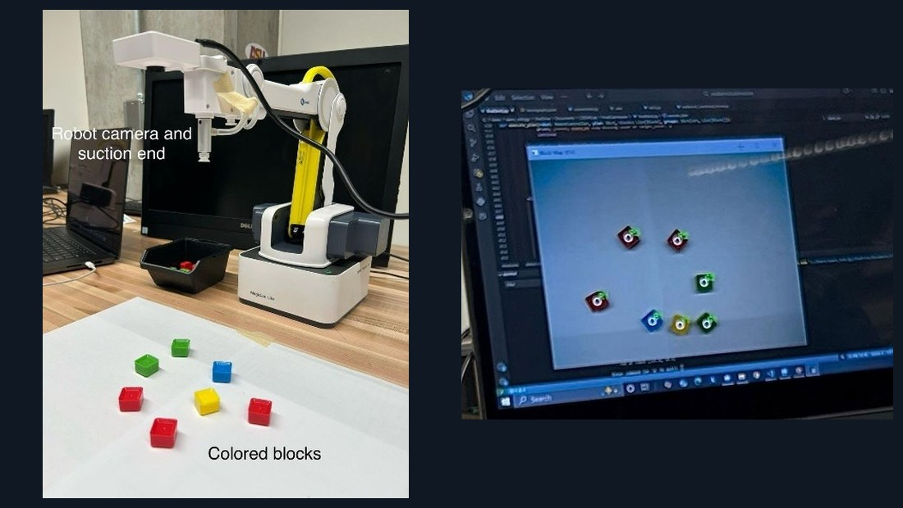
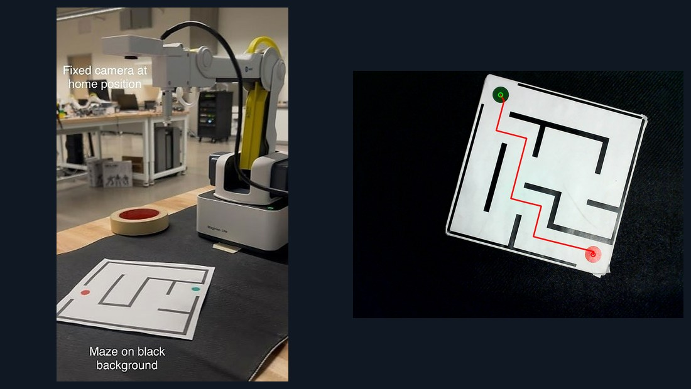
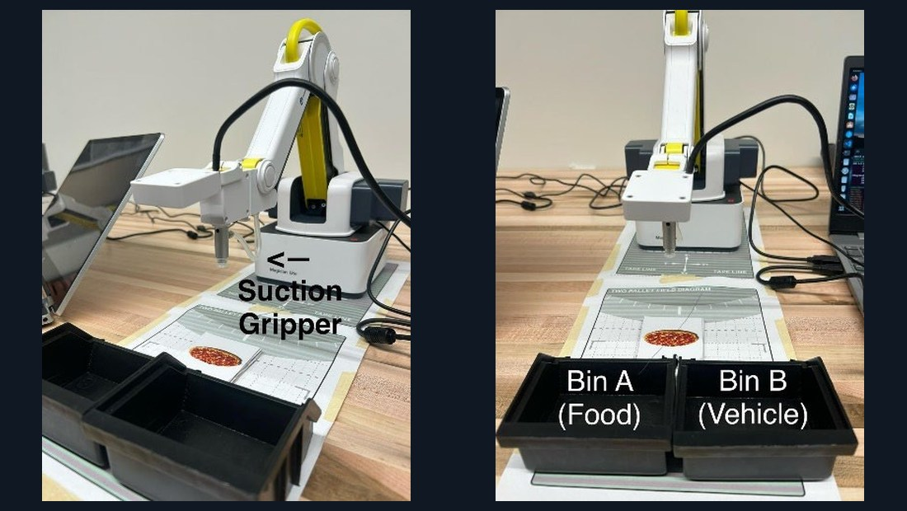
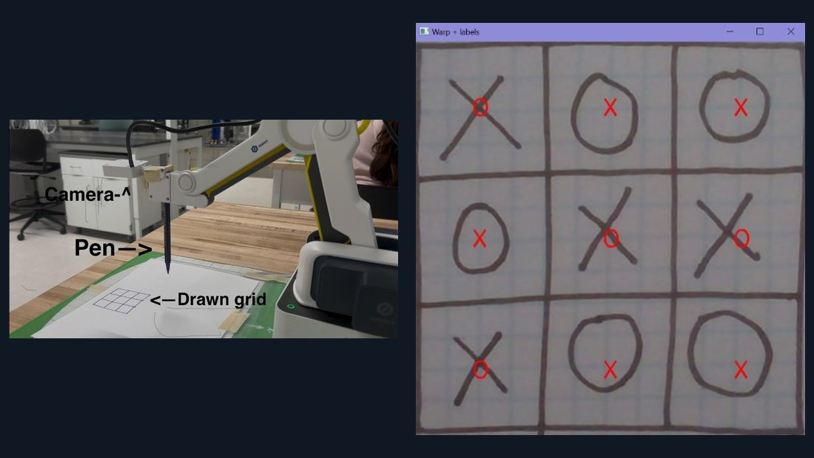
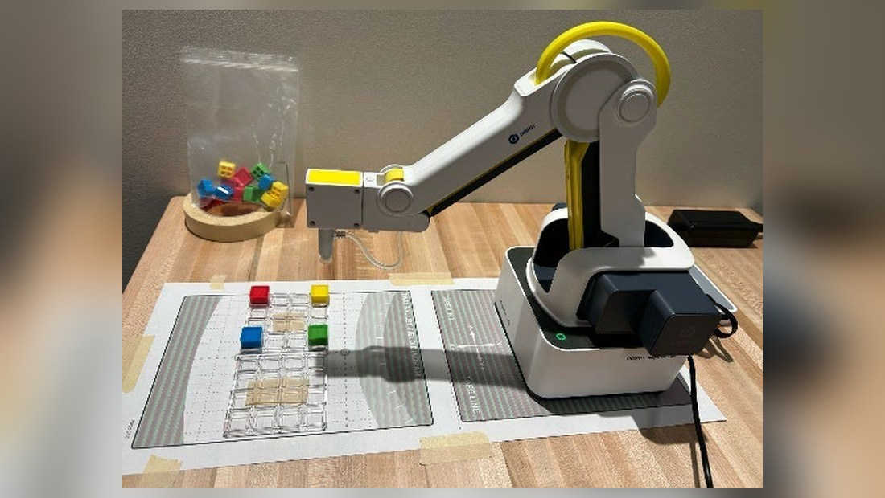

<div align="center">

# Dobot Robotics Projects

**Robotic manipulation · Computer vision · Autonomous planning · Human-robot interaction**

A collection of five hands-on projects using the **Dobot Magician Lite** to connect perception, decision-making, and physical robot motion. Explore the demonstrations, results, engineering approaches, and technical reports for each project.

**[▶ Watch all project demonstrations on YouTube](https://youtube.com/playlist?list=PLA4MDF3pUzjA)**

**[Project gallery](#project-gallery)** · **[Repository guide](#repository-guide)**

</div>

---

## Project gallery

Every project has a visual overview, a demonstration video, and a technical report describing its design and results.

<table>
  <tr>
    <td width="42%" align="center" valign="middle">
      <a href="natural-language-pick-place/README.md"></a>
    </td>
    <td width="58%" valign="middle">
      <h3>Natural-Language Pick-and-Place with Gemini</h3>
      <p>Tell the robot what to do in natural language. Colored blocks are detected with a camera, Gemini returns a structured action plan, and a calibrated Dobot executes pickup, stacking, or relative placement.</p>
      <p><code>Python</code> <code>Gemini</code> <code>OpenCV</code> <code>JSON planning</code></p>
      <p><a href="natural-language-pick-place/README.md"><strong>Project overview</strong></a> &nbsp;·&nbsp; <a href="https://youtu.be/ppjOnzXohbc"><strong>Video demo</strong></a> &nbsp;·&nbsp; <a href="natural-language-pick-place/docs/lab_report.pdf"><strong>Lab report</strong></a></p>
    </td>
  </tr>
  <tr>
    <td width="42%" align="center" valign="middle">
      <a href="autonomous-maze-solving/README.md"></a>
    </td>
    <td width="58%" valign="middle">
      <h3>Autonomous Maze Solving</h3>
      <p>Camera-to-robot maze solver: rectify an image, build a grid, find a BFS path, and physically trace the route using pixel-to-robot homography.</p>
      <p><code>Python</code> <code>OpenCV</code> <code>BFS</code> <code>Homography</code></p>
      <p><a href="autonomous-maze-solving/README.md"><strong>Project overview</strong></a> &nbsp;·&nbsp; <a href="https://youtu.be/d2KFqwhLtJA"><strong>Video demo</strong></a> &nbsp;·&nbsp; <a href="autonomous-maze-solving/docs/lab_report.pdf"><strong>Lab report</strong></a></p>
    </td>
  </tr>
  <tr>
    <td width="42%" align="center" valign="middle">
      <a href="object-detection-palletizing/README.md"></a>
    </td>
    <td width="58%" valign="middle">
      <h3>Object Detection & Palletizing</h3>
      <p>Uses YOLO detections to classify printed objects as food or vehicles, then picks and sorts each object into its assigned pallet.</p>
      <p><code>Python</code> <code>YOLO</code> <code>Computer vision</code> <code>Robotics</code></p>
      <p><a href="object-detection-palletizing/README.md"><strong>Project overview</strong></a> &nbsp;·&nbsp; <a href="https://youtu.be/YzFnglL5R7w"><strong>Video demo</strong></a> &nbsp;·&nbsp; <a href="object-detection-palletizing/docs/lab_report.pdf"><strong>Lab report</strong></a></p>
    </td>
  </tr>
  <tr>
    <td width="42%" align="center" valign="middle">
      <a href="robotic-tic-tac-toe/README.md"></a>
    </td>
    <td width="58%" valign="middle">
      <h3>Robotic Tic-Tac-Toe</h3>
      <p>A pen-equipped robot plays tic-tac-toe against a human, detecting marks with a camera and using minimax to decide where to draw next.</p>
      <p><code>Python</code> <code>OpenCV</code> <code>Minimax</code> <code>HRI</code></p>
      <p><a href="robotic-tic-tac-toe/README.md"><strong>Project overview</strong></a> &nbsp;·&nbsp; <a href="https://youtu.be/Gvnxh9V4Tv8"><strong>Video demo</strong></a> &nbsp;·&nbsp; <a href="robotic-tic-tac-toe/docs/lab_report.pdf"><strong>Lab report</strong></a></p>
    </td>
  </tr>
  <tr>
    <td width="42%" align="center" valign="middle">
      <a href="pick-place-end-effectors/README.md"></a>
    </td>
    <td width="58%" valign="middle">
      <h3>Pick-and-Place: Suction vs. Gripper</h3>
      <p>Compared vacuum suction and a mechanical gripper in a four-block pallet-transfer task. Optimizing the suction sequence reduced the measured full-cycle time by <strong>52.8%</strong>.</p>
      <p><code>Python</code> <code>Robot control</code> <code>Motion optimization</code></p>
      <p><a href="pick-place-end-effectors/README.md"><strong>Project overview</strong></a> &nbsp;·&nbsp; <a href="https://youtu.be/mT_Njtg9VYs"><strong>Video demo</strong></a> &nbsp;·&nbsp; <a href="pick-place-end-effectors/docs/lab_report.pdf"><strong>Lab report</strong></a></p>
    </td>
  </tr>
</table>

---

## Repository guide

This repository is a **visual and technical showcase**, with five individually documented robotics projects. Each project folder contains a README describing the problem, approach, and results; `assets/` holds genuine experiment images; and `docs/` contains the lab report and hardware/technical notes.

**Source code is not published in accordance with course guidance.** The linked demonstrations and reports document the completed work.

```text
dobot-robotics-projects/
├── README.md
├── natural-language-pick-place/
│   ├── README.md
│   ├── assets/
│   └── docs/
├── autonomous-maze-solving/
│   ├── README.md
│   ├── assets/
│   └── docs/
├── object-detection-palletizing/
│   ├── README.md
│   ├── assets/
│   └── docs/
├── robotic-tic-tac-toe/
│   ├── README.md
│   ├── assets/
│   └── docs/
└── pick-place-end-effectors/
    ├── README.md
    ├── assets/
    └── docs/
```

## Notes

- **Project context:** these experiments were developed in RAS 545 at Arizona State University using the Dobot Magician Lite and supporting vision/planning tools.
- **Technical scope:** the READMEs explain the architecture, experimentation, and key decisions without distributing the source implementations.
- **Reports and visuals:** `docs/lab_report.pdf` provides the corresponding report; images and results come from the original experiments. Reports were cleaned of shared-conversation and course-material links for public presentation.
- **Hardware limitations:** the reported observations are tied to the original robot, calibration, camera, workspace, and software environment; they should not be treated as guaranteed results on a different system.

---

<sub>Robotics projects by Saanvi Agrawal · RAS 545, Arizona State University · 2025</sub>
