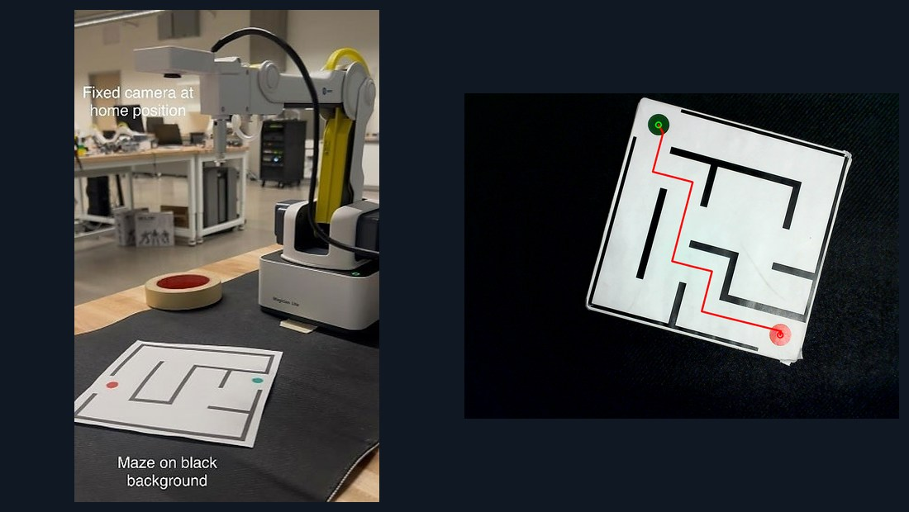
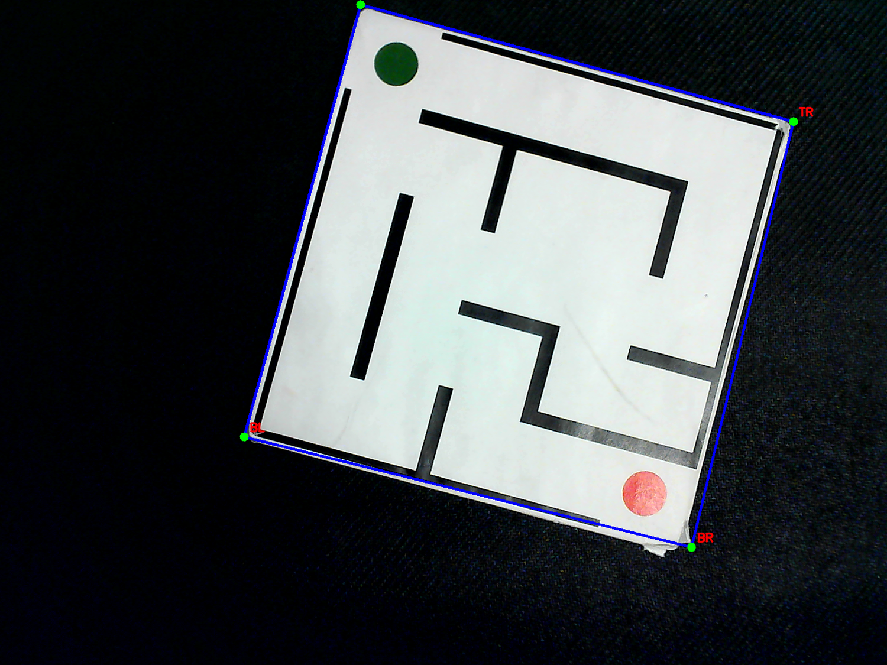
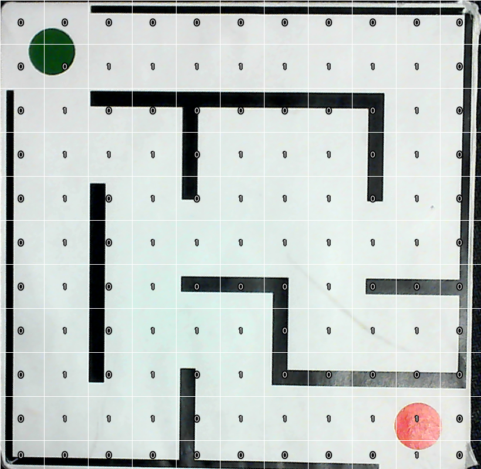
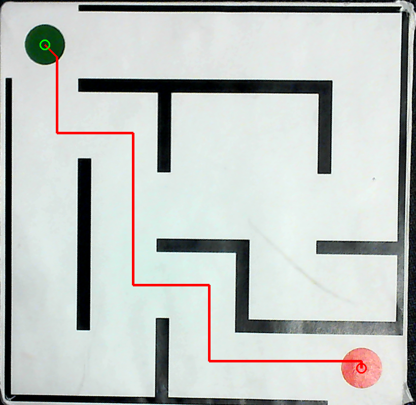
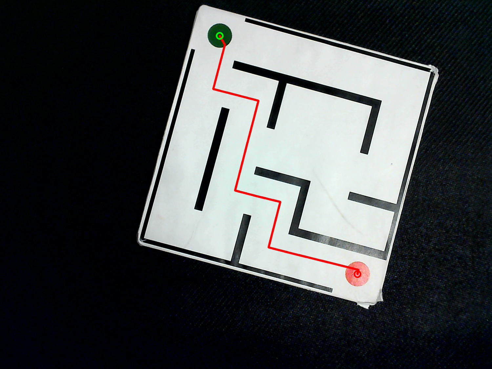

# Autonomous Maze Solving: From Camera Image to Robot Motion

**Dobot Magician Lite · OpenCV · BFS · Gemini Vision · Homography · Python**

Built an end-to-end system that **captures a printed maze, reconstructs a navigable grid, finds a path with breadth-first search (BFS), and traces the solution with the Dobot Magician Lite**. A homography links camera pixels to robot coordinates.

[**Watch the demonstration**](https://youtu.be/d2KFqwhLtJA) · [**Read the project report (PDF)**](docs/lab_report.pdf) · [**Hardware notes**](docs/setup.md)



## The challenge

A path found on a camera image is not yet a usable robot trajectory. The image may be rotated, the maze walls imperfectly segmented, and start/end markers distorted by lighting. The project bridges **perception → discrete path planning → physical actuation**, with visual intermediate outputs to debug every stage.

**Skills demonstrated:** classical computer vision, contour detection, homography calibration, perspective warping, BFS pathfinding, graph/grid modeling, multimodal Gemini inference, and robot control.

## System and tools

| Component | Purpose |
| --- | --- |
| **Dobot Magician Lite + pen** | Physically trace the planned maze route |
| **Camera + OpenCV** | Capture image, detect maze quadrilateral, and correct perspective |
| **Grid occupancy map** | Represent walls and navigable space as cells |
| **Breadth-first search (BFS)** | Find a valid shortest path through unweighted free-space cells |
| **Gemini vision** | Help distinguish red/green start/end markers under difficult lighting |
| **Homography transform** | Convert the calculated image-space path to millimeter robot coordinates |

## The pipeline

1. **Capture and locate.** Move the arm to a camera view pose, take a frame, and detect the maze's outer quadrilateral using contours.
2. **Rectify and interpret.** Warp the maze to a top-down image, find colored endpoints, and construct a wall/free-space grid.
3. **Plan.** Run BFS from the chosen start to the finish, producing a list of grid cells along the route.
4. **Project back.** Unwarp the path into camera image coordinates, map those points into robot coordinates with a calibrated homography, and command the arm to follow the path.

```text
Camera capture → Corner detection → Perspective warp
                                           ↓
                  Detect endpoints → Grid occupancy map
                                           ↓
                                       BFS path
                                           ↓
                         Unwarp → Pixel-to-robot → Trace
```

### Visualizing the intermediate outputs

<table>
  <tr>
    <td width="33%" align="center"><br/><sub>Corner detection</sub></td>
    <td width="33%" align="center"><br/><sub>Grid representation</sub></td>
    <td width="33%" align="center"><br/><sub>Planned path</sub></td>
  </tr>
</table>



## Results and engineering decisions

The report describes the complete pipeline successfully producing corner overlays, warped mazes, wall masks, valid BFS routes, and robot-executable traces. Earlier experiments with a **custom YOLO maze-corner detector** produced inconsistent corner locations; the final system switched to **classical contour-based geometry**, which was more consistent in the controlled printed-maze environment. Gemini assisted with marker-color classification after HSV-based color rules struggled with glare.

The remaining sensitivity is calibration: if a maze moves after capture or falls outside the calibrated area, the projected trajectory can drift. Results are qualitative observations from the class experiment, not a separately measured robot path error benchmark.

## Project materials

The public portfolio includes project documentation and demonstration materials; **source code is not distributed in accordance with course guidance**.

| Resource | What it contains |
| --- | --- |
| [Demo video](https://youtu.be/d2KFqwhLtJA) | Camera-to-robot maze-solving demonstration |
| [Project report](docs/lab_report.pdf) | Vision pipeline, BFS planning, results, and limitations |
| [Hardware and technical notes](docs/setup.md) | Original experimental configuration and calibration context |
| [Project images](assets/) | Maze captures, corner detections, grid and solution overlays |
| [Archived experiment data](docs/) | Saved example calibration and route outputs |

## Resources

- [Video demonstration](https://youtu.be/d2KFqwhLtJA)
- [Full project report (PDF)](docs/lab_report.pdf)
- [Hardware and technical notes](docs/setup.md)
