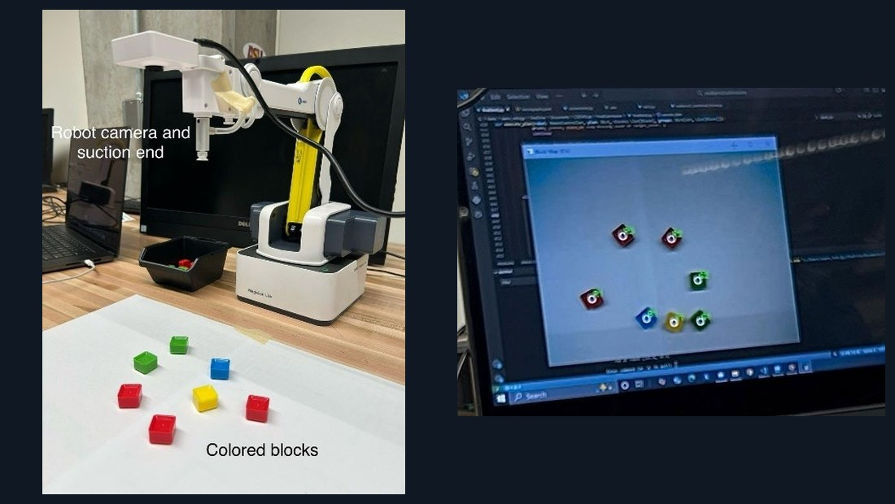
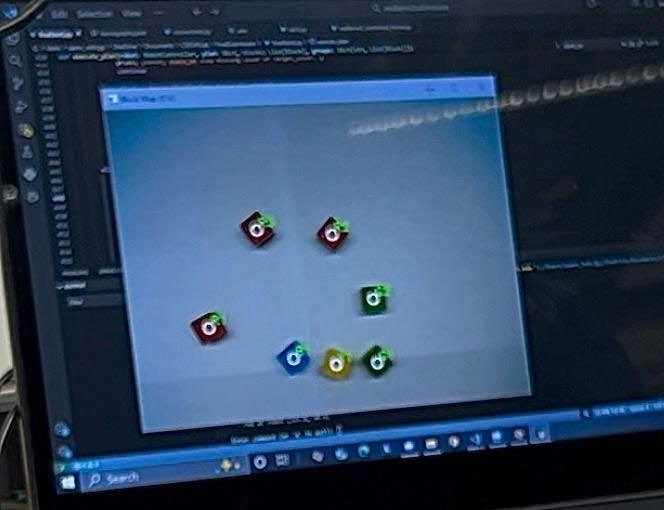

# Natural-Language Robotic Pick-and-Place with Gemini

**Dobot Magician Lite · Gemini · Python · OpenCV · Structured planning**

Created an LLM-guided robot interface that turns instructions such as **"pick up the red block and place it next to the green block"** into structured manipulation steps. A camera detects available blocks, Gemini converts a request into a constrained plan, and the Dobot Magician Lite executes the resulting pick, stack, or relative-placement actions.

[**Watch the demonstration**](https://youtu.be/ppjOnzXohbc) · [**Read the project report (PDF)**](docs/lab_report.pdf) · [**Hardware notes**](docs/setup.md)



## The challenge

Natural language describes **what a person wants**, while a robot needs specific object identities and physical target coordinates. The system separates these concerns: **computer vision** identifies candidate blocks, an **LLM** produces a plan using a limited action vocabulary, and **deterministic robot code** executes only the supported operations.

**Skills demonstrated:** multimodal/LLM integration, structured JSON planning, robotic manipulation, perception-to-action pipelines, homography calibration, prompt design, and human-in-the-loop disambiguation.

## System and tools

| Component | Role |
| --- | --- |
| **Dobot Magician Lite + suction cup** | Pick up and position physical colored blocks |
| **Camera + OpenCV** | Segment colored blocks and estimate their centers |
| **Pixel-to-robot homography** | Convert detected block coordinates into robot workspace coordinates |
| **Gemini via Google Gen AI SDK** | Interpret user instructions and generate structured action plans |
| **Python executor** | Validate/interpret plan steps and execute supported motions |
| **Console disambiguation** | Choose a specific block when multiple objects have the same color |

## How it works

1. **Observe the workspace.** Capture an image, detect the colored blocks, and label them so the person can inspect the scene interpretation.
2. **Interpret a request.** Provide the scene description and a natural-language instruction to Gemini, requesting a plan in a constrained JSON format.
3. **Resolve ambiguity.** When a color matches more than one physical block, use a block-index selection step instead of silently guessing.
4. **Execute actions.** Translate validated plan steps to pickup, placement, stacking, or directional relative-placement motions, using the calibrated pixel-to-robot mapping.

```text
Camera → Detect and label blocks → Scene representation
                                          ↓
                            User instruction → Gemini
                                          ↓
                                 Structured JSON plan
                                          ↓
                               Select object if needed
                                          ↓
                                Robot motion executor
```



## Results and lessons learned

The final report describes a working integration of block detection, language-to-JSON planning, and robot execution. It notes that the **camera resolution changed** during development, requiring a new homography; once recalibrated, positions aligned more consistently. The **fixed JSON action schema** helped constrain the model's outputs, while indexed block selection made same-color cases manageable without adding that decision to the prompt. Relative placement directions also needed sign tuning.

The implementation illustrates an important boundary: an LLM supplies a high-level intent interpretation, but physical safety still depends on calibration, supported action types, and deliberate execution checks. The report records qualitative successes, not a formal benchmark of language-understanding or manipulation accuracy.

## Project materials

The public portfolio includes project documentation and demonstration materials; **source code is not distributed in accordance with course guidance**.

| Resource | What it contains |
| --- | --- |
| [Demo video](https://youtu.be/ppjOnzXohbc) | Natural-language commands translated into physical actions |
| [Project report](docs/lab_report.pdf) | Technical design, calibration, experiments, and lessons |
| [Hardware and technical notes](docs/setup.md) | Original robot, camera, and software context |
| [Project images](assets/) | Robot setup and color-block detections |
| [Archived calibration example](docs/homography_example.json) | Experimental coordinate-mapping data (not portable to other setups) |

## Resources

- [Video demonstration](https://youtu.be/ppjOnzXohbc)
- [Full project report (PDF)](docs/lab_report.pdf)
- [Hardware and technical notes](docs/setup.md)

<sub>RAS 545 · Arizona State University · 2025</sub>
