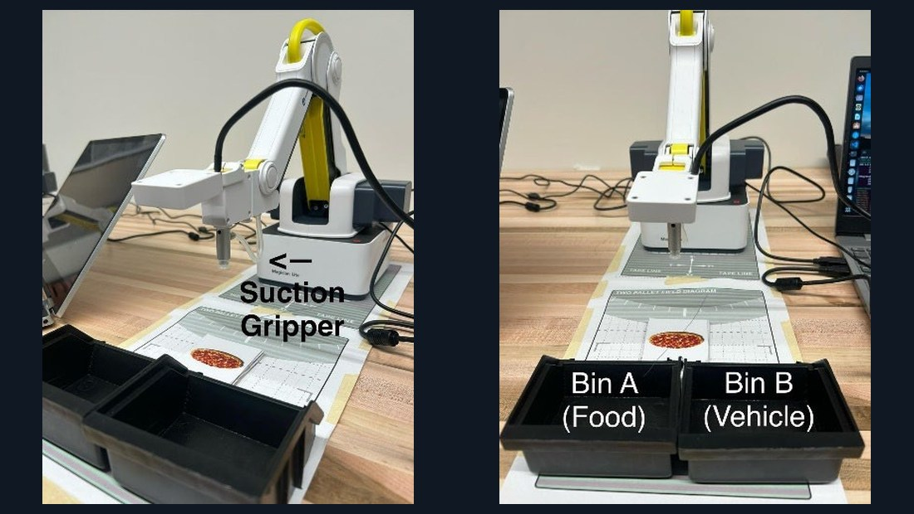
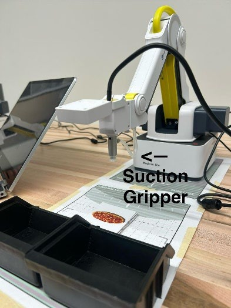
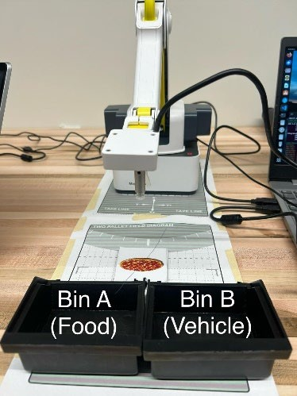

# Object Detection & Robotic Palletizing

**Dobot Magician Lite · Python · YOLO · OpenCV · Vision-guided manipulation**

Built a perception-to-action pipeline that recognizes printed objects as **food or vehicles** and instructs a Dobot Magician Lite to sort them into the corresponding pallets using suction. Unlike a fixed pick-and-place sequence, each destination depends on a camera-based classification.

[**Watch the demonstration**](https://youtu.be/YzFnglL5R7w) · [**Read the lab report (PDF)**](docs/lab_report.pdf) · [**Hardware notes**](docs/setup.md)



## The task

The robot operates between a pickup area and two labeled pallets. A camera captures an image at a designated detection pose, a YOLO model identifies the object category, and the controller moves the item to **Pallet A (food)** or **Pallet B (vehicles)**. The system repeats the loop rather than assuming every object follows a predetermined route.

**Skills demonstrated:** computer vision, object classification, robotics control, Python, camera/robot calibration, confidence-based decision making, and hardware debugging.

## System and tools

| Component | Role in the system |
| --- | --- |
| **Dobot Magician Lite + suction cup** | Physical picking, transfer, and placement |
| **USB camera + OpenCV** | Capture an image from the robot's detection pose |
| **Ultralytics YOLO** | Detect object labels in the camera feed |
| **Python + pydobot control API** | Home, navigate between taught poses, actuate suction, and repeat cycles |
| **Category mapping** | Route recognized food objects to one pallet and vehicles to another |

## How it works

1. **Move to a dedicated detection pose.** The camera is positioned so the printed object is actually visible, independent of the pickup position.
2. **Classify with YOLO.** The program filters detections by confidence, collects votes across multiple frames, and maps supported labels into food or vehicle categories.
3. **Pick up the object.** The robot moves to the recorded pickup coordinates, activates suction, and lifts the item.
4. **Sort and repeat.** It moves to the selected pallet, releases the object, and returns for the next detection.

```text
Detection pose → Camera frame → YOLO predictions → Category vote
                                               ↓
                              Food → Pallet A   |   Vehicle → Pallet B
                                               ↓
                                  Pick → Place → Repeat
```

<table>
  <tr>
    <td width="50%"></td>
    <td width="50%"></td>
  </tr>
</table>

## Results and engineering decisions

The submitted report describes **six full sorting cycles**. The biggest improvements came from correcting the camera's field of view and using a **separate detection pose**: at the original pickup location, the object was sometimes outside the visible image region. The system also used a higher confidence threshold and multiple-frame voting to reduce uncertain actions. YOLO inference was restricted to the detection phase rather than running throughout robot movement.

**What mattered most:** a high-performing detector alone was not enough. Camera alignment, discrete robot states, USB/camera device selection, and reliable suction timing determined whether the complete system could sort objects consistently.

The report provides observations from a class lab, not a benchmarked precision/recall study. Future work would include more object categories, quantitative confusion matrices, and verification after each drop.

## Project materials

The public portfolio includes project documentation and demonstration materials; **source code is not distributed in accordance with course guidance**.

| Resource | What it contains |
| --- | --- |
| [Demo video](https://youtu.be/YzFnglL5R7w) | Vision-guided object sorting and palletizing |
| [Project report](docs/lab_report.pdf) | Methodology, observed behavior, and lessons |
| [Hardware and technical notes](docs/setup.md) | Robot, camera, and vision stack |
| [Project images](assets/) | Robot and pallet setup photographs |

## Resources

- [Video demonstration](https://youtu.be/YzFnglL5R7w)
- [Full lab report (PDF)](docs/lab_report.pdf)
- [Hardware and technical notes](docs/setup.md)

<sub>RAS 545 · Arizona State University · 2025</sub>
