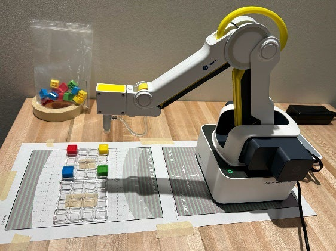
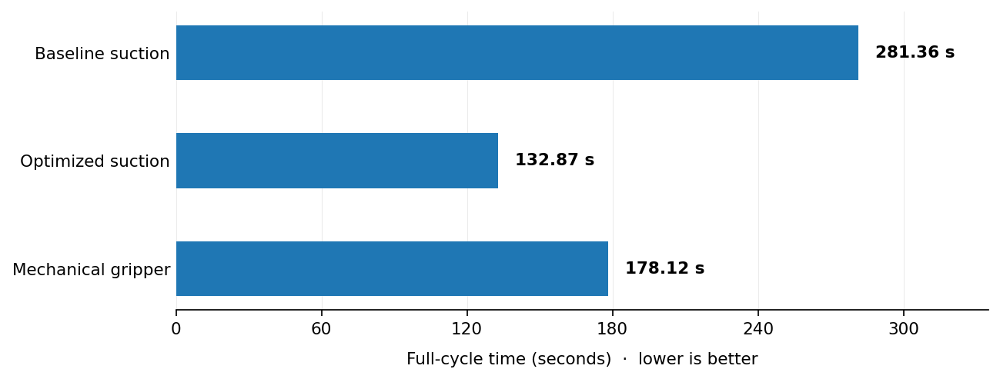
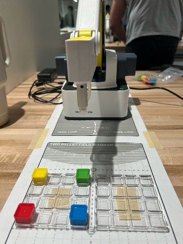
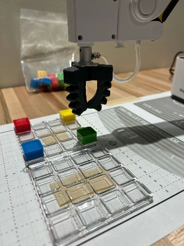

# Pick-and-Place with Suction vs. Mechanical Gripper

**Dobot Magician Lite · Python · Robotic manipulation · Motion optimization**

Programmed a physical robotic arm to **pick up four blocks, transfer them to a second pallet, and return them to their starting positions**. The project compares a vacuum suction cup with a mechanical gripper and investigates how pose calibration and motion choices affect execution time.

[**Watch the demonstration**](https://youtu.be/mT_Njtg9VYs) · [**Read the lab report (PDF)**](docs/lab_report.pdf) · [**Hardware setup**](docs/setup.md)



## 1. The task

The robot operates on two four-position pallets. For each block, it must approach the source position, grasp the block, move to the corresponding destination, release it, and later reverse the sequence. This makes a useful controlled experiment: **the task stays the same while the end effector and motion strategy change**.

**Project goals**

- Implement a complete, repeatable transfer-and-return cycle using taught robot coordinates.
- Compare **suction** and **mechanical gripping** on the same 17 mm plastic blocks.
- Refine the suction trajectory to reduce unnecessary movement and cycle time.
- Document practical issues such as reachability, pallet clearance, and grasp/release timing.

> Developed for **RAS 545** at Arizona State University. The measurements below describe the reported lab trials, not an independently replicated benchmark.

## 2. System and tools

| Component | What it was used for |
| --- | --- |
| **Dobot Magician Lite** | Physical robot arm executing point-to-point motion |
| **Vacuum suction cup** | Pick and release smooth plastic cubes through vacuum control |
| **Mechanical gripper** | Pick and release the same cubes through jaw actuation |
| **Python + Dobot control API** | Motion commands, end-effector actuation, pose checks, and cycle timing |
| **Taught `(x, y, z, r)` poses** | Source and destination locations, intermediate positions, and safe approach heights |

**Skills demonstrated:** Python programming, robotic manipulation, point-to-point motion planning, coordinate calibration, hardware debugging, experiment design, and comparative performance analysis.

## 3. Implementation: from baseline to optimized motion

### Step 1 — Calibrate the workspace

Recorded the robot's home position and the corresponding source/destination poses on both pallets. Each script uses those coordinates to pair the four source blocks with their destinations. Per-corner **Z offsets** compensate for reachability differences, including a problematic fourth-corner position.

### Step 2 — Build the suction pick-and-place sequence

The initial controller uses a **hover → descend → suction on → lift → transfer → descend → suction off** routine. It also routes movements through an intermediate point, checks the reported pose against a tolerance, and tries a slightly higher Z position if the initial descent is not reached.

### Step 3 — Shorten the suction trajectory

The optimized controller adjusts speed and hover parameters and removes repeated intermediate trips, while retaining the pickup/placement sequence and corner-specific height corrections. It performs the same four-block transfer and return task with less travel overhead.

### Step 4 — Adapt the controller for the gripper

The gripper implementation changes the actuation sequence from vacuum control to **opening and closing the jaws**. Because the gripper is physically larger, its approach and contact heights required additional tuning to avoid the edges of the pallet.

**Motion flow (both approaches):**

```text
Home / approach
      ↓
Hover above source → descend → grasp
      ↓
Lift and transfer → hover above destination
      ↓
Descend → release → lift
      ↓
Repeat for four blocks → return all blocks to source
```

## 4. Results and what changed

The report records a full **four-block transfer-and-return cycle** for each configuration:

| Configuration | Full-cycle time | Takeaway |
| --- | ---: | --- |
| Suction · baseline | **281.36 s** | Conservative motion and repeated intermediate travel |
| Suction · optimized | **132.87 s** | Fewer unnecessary movements; **52.8% less time** than baseline |
| Mechanical gripper | **178.12 s** | Successful after approach-height adjustments; slower than optimized suction |



The optimized suction controller completed the reported task in **148.49 fewer seconds**, roughly **2.12× the baseline throughput** for this run. The gripper required additional clearance tuning but handled the tested blocks after calibration. These results reflect a small set of lab runs and **do not establish general reliability across other objects or conditions**.

## 5. Engineering challenges and lessons

<table>
  <tr>
    <td width="50%" valign="top">
      
      <p><strong>Suction cup</strong></p>
      <p>Maintaining the right pickup height and dwell time was important for establishing and releasing suction. The fourth block also required a Z adjustment. Removing redundant moves yielded the largest observed cycle-time improvement.</p>
    </td>
    <td width="50%" valign="top">
      
      <p><strong>Mechanical gripper</strong></p>
      <p>The larger jaws risked contacting pallet edges. Adjusting approach and contact heights improved alignment and placement, illustrating how end-effector geometry changes the feasible motion path.</p>
    </td>
  </tr>
</table>

**What I'd improve next:** repeat each configuration over more trials, test different materials and geometries, measure task success rates, and separate motion time from end-effector actuation time. Those would support a stronger reliability comparison than single-run timing alone.

## 6. Project materials

The public portfolio includes project documentation and demonstration materials; **source code is not distributed in accordance with course guidance**.

| Resource | What it contains |
| --- | --- |
| [Demo video](https://youtu.be/mT_Njtg9VYs) | Suction and gripper manipulation |
| [Project report](docs/lab_report.pdf) | Experimental method, cycle timings, and comparison |
| [Hardware and technical notes](docs/setup.md) | Original robot and end-effector hardware setup |
| [Project images](assets/) | End effectors and cycle-time comparison chart |

## 7. Resources

- [Demonstration video on YouTube](https://youtu.be/mT_Njtg9VYs)
- [Full lab report (PDF)](docs/lab_report.pdf)
- [Hardware and technical notes](docs/setup.md)

<sub>Project by Saanvi Agrawal · RAS 545, Arizona State University · 2025</sub>
