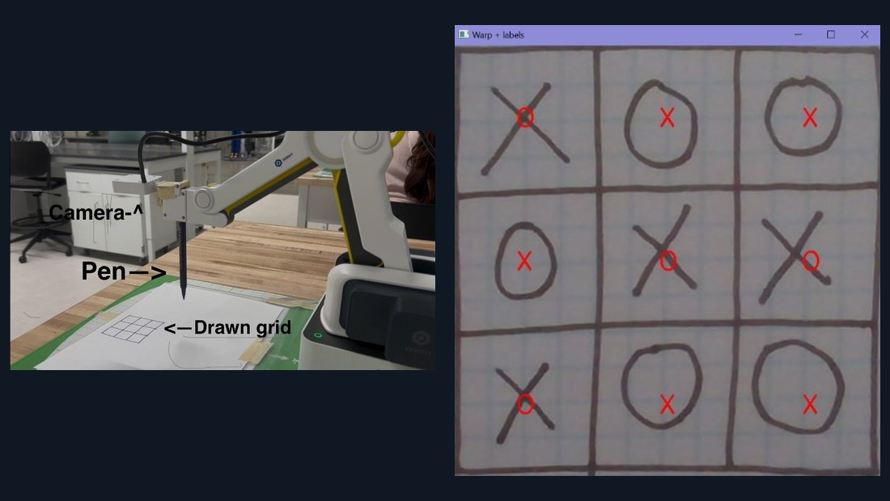
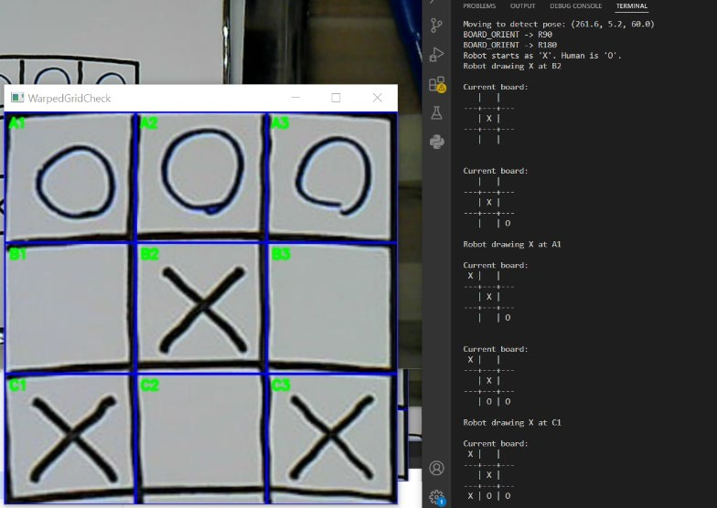

# Robotic Tic-Tac-Toe with Computer Vision & Minimax

**Dobot Magician Lite · Python · OpenCV · Minimax · Human-robot interaction**

Built a robot opponent that **draws a tic-tac-toe grid, reads human moves through a camera, chooses a response with minimax, and draws its move** using a pen attached to a Dobot Magician Lite.

[**Watch the demonstration**](https://youtu.be/Gvnxh9V4Tv8) · [**Read the project report (PDF)**](docs/lab_report.pdf) · [**Hardware notes**](docs/setup.md)



## The challenge

Connect three systems that must agree on a shared board: **visual perception** identifies the current human move, **game logic** picks a strategic move, and **robot control** translates the selected cell into physical pen strokes. Detection errors are particularly costly because a wrong cell interpretation produces a logically valid but physically incorrect response.

**Skills demonstrated:** human-robot interaction, game search algorithms, perspective transforms, ROI detection, image classification, inverse mapping, motion control, and Python debugging.

## System and tools

| Component | Role |
| --- | --- |
| **Dobot Magician Lite + pen** | Draw the board and the robot's moves |
| **Camera + OpenCV** | Crop/warp the board and interpret hand-drawn X/O marks |
| **Minimax** | Evaluate possible moves and choose a strategic response |
| **Taught board coordinates** | Map the nine grid cells to pen motions in the robot workspace |
| **Python controller** | Coordinate gameplay, image acquisition, decision logic, and drawing |

## How it works

1. **Create the board.** The arm draws a **60 mm × 60 mm** three-by-three grid using predefined calibrated points.
2. **Read the human move.** A camera captures the board; perspective/region-of-interest processing separates it into cells and classifies X and O markings.
3. **Update the game state.** The controller checks the board state, handles move stability, and passes the position to minimax.
4. **Draw the response.** The robot navigates to the chosen cell, draws its mark, and waits for the next human move.

```text
Draw grid → Capture board → Detect occupied cells
                                     ↓
                          Minimax chooses move
                                     ↓
                        Map cell to XY → Draw mark
                                     ↓
                            Repeat until game ends
```



## Results and lessons learned

The report documents a successful software-camera prototype and a physical robot implementation capable of drawing the grid and playing tic-tac-toe. The **minimax/game loop worked**, but physical trials exposed difficulties with **symbol localization**. Blue grid lines, perspective distortion, and changes in board alignment confused the vision pipeline. Moving from a manually chosen ROI to programmatic board selection/warping improved consistency without fully eliminating incorrect cell positions.

**Key lesson:** a correct decision algorithm does not compensate for inaccurate perception or calibration. Better board-to-camera mapping and more robust cell-level detection would be the next improvements. The report does not claim perfect detection accuracy or an always-unbeatable physical system.

## Project materials

The public portfolio includes project documentation and demonstration materials; **source code is not distributed in accordance with course guidance**.

| Resource | What it contains |
| --- | --- |
| [Demo video](https://youtu.be/Gvnxh9V4Tv8) | Robotic tic-tac-toe with a human player |
| [Project report](docs/lab_report.pdf) | Perception/game logic, experimental observations, and limitations |
| [Hardware and technical notes](docs/setup.md) | Robotic pen, board and camera setup |
| [Project images](assets/) | Board detection and robot gameplay |

## Resources

- [Video demonstration](https://youtu.be/Gvnxh9V4Tv8)
- [Full project report (PDF)](docs/lab_report.pdf)
- [Hardware and technical notes](docs/setup.md)

<sub>RAS 545 · Arizona State University · 2025</sub>
